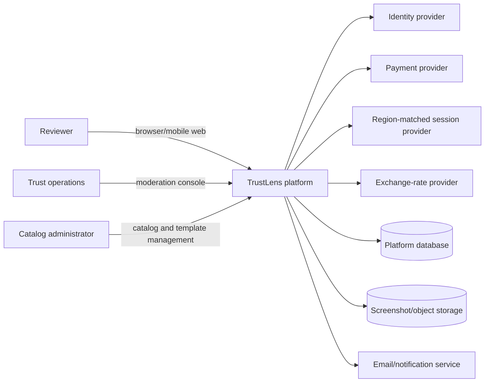
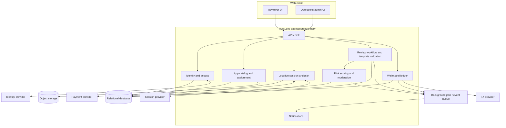
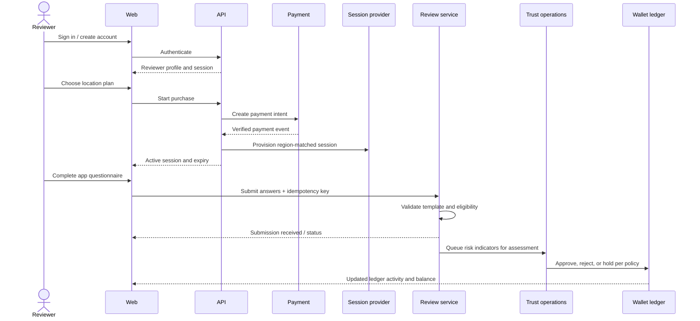
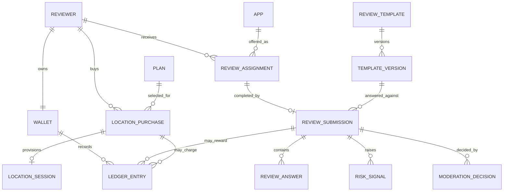

# TrustLens — software architecture model

> **Superseded draft:** This earlier model covers only the original app-review prototype. The current expanded project architecture, including sponsor ad sharing, subscriptions, wallets, payment providers, location entitlements and push notifications, is in [software-architecture-model.md](software-architecture-model.md), section 12.

**Status:** review draft  
**Source:** `project-overview.html` (single-page UI prototype)  
**Purpose:** translate the owner's interface and stated workflow into an implementation-oriented architecture. This document distinguishes what the page shows from design decisions proposed for a production system.

## 1. Executive summary

TrustLens is a marketplace workflow connecting app reviewers with app listings. Reviewers create an account, purchase a time-limited region-matched session, complete structured app reviews, and receive wallet credits. A trust/review operation assesses submissions and app risk signals; a wallet supports withdrawal and currency display.

The HTML is a visual/interaction prototype, not an implemented backend. Its login is local, its checkout is simulated, reviews are immediately marked done and credited in memory, the session is a timer, and exchange rates come from a public API with fallback values. Production architecture must replace these behaviors with authenticated APIs, durable records, payment-provider confirmation, real session provisioning, server-side review workflows, and auditable ledger transactions.

## 2. Evidence and interpretation

| Page evidence | Architecture interpretation |
|---|---|
| Login fields, country choice, Google button; `login()` creates a local user | Reviewer identity and authentication capability (provider and verification policy unresolved) |
| Dashboard gates app tasks on an active location; day/week plans and card form | Purchase and provision a region-matched session; payment provider and actual session technology are unspecified |
| Three app examples, store listing details, screenshots, review questionnaire | App catalog plus configurable, versioned review templates and answers |
| Review answers include safety signals and a verdict; completion immediately displays a result | Submission and risk-triage workflow; prototype does not demonstrate moderation or approval logic |
| UI copy says ₦600 per approved review, “on submit,” and verification within an hour | Business-rule conflict: whether credit is provisional on submit or payable only after approval needs an owner decision |
| Wallet shows balance, activity, conversion rates | NGN-denominated ledger and read-only currency conversion; no withdrawal flow is shown |
| `APPS`, `PLANS`, `S`, and inline handlers in the script | Prototype data/state live in one browser page; production needs persistent server-owned state |

Evidence boundary: observations are limited to `project-overview.html`; the proposed services and data model below are design inferences for a buildable system, not facts about an existing implementation.

## 3. Scope and system context

### Actors

- **Reviewer:** registers, purchases a session, reviews assigned apps, sees earnings and activity.
- **Trust operations reviewer:** reviews flagged submissions/apps and applies moderation outcomes (inferred role needed by the stated verification process).
- **Administrator / catalog operator:** maintains app listings, store metadata, screenshots, review templates, prices and eligibility (inferred operational role).
- **External providers:** identity/OAuth, payment processing, session/location infrastructure, and exchange-rate feed.

### Context diagram

The user-facing app should never collect or store raw card numbers/CVV. The prototype's card form must be replaced by provider-hosted checkout or tokenized fields.

## 4. Proposed logical architecture

### Component responsibilities

| Component | Owns |
|---|---|
| Web client | Screen navigation, accessible questionnaire controls, local draft answers and presentation. No authoritative balance, eligibility, approval, or payment state. |
| API / BFF | Authenticated request boundary, input validation, response shaping, rate limiting and correlation IDs. |
| Identity and access | Reviewer accounts, sessions, OAuth callback, roles, account status and duplicate-account controls. |
| App catalog and assignment | Store listing data, screenshots, task availability, assignment and reviewer eligibility. |
| Location session and plan | Plan catalog, payment intent initiation, verified payment callback, session provisioning/expiry and review quota enforcement. |
| Review workflow | Template versions, draft/submission lifecycle, answer validation, idempotent submission and immutable submitted answers. |
| Risk and moderation | Deterministic risk indicators from answers, queueing, human decisions, reasons and appeal/audit history. A score is a triage aid, not an automatic truth determination. |
| Wallet and ledger | Append-only NGN credits/debits, holds/reversals, balance projection, transaction history, payout eligibility and FX display conversion. |
| Background jobs / notifications | Provider callbacks, session expiry, review SLA reminders, moderation queue work and user notifications. |

## 5. Key user flows

### Reviewer journey

The production flow should make submission acceptance, moderation outcome, and funds availability separate states. The page's “paid on submit” wording and “per approved review” wording must be resolved before choosing the exact ledger timing.

### Review state model (proposed)

`ASSIGNED → IN_PROGRESS → SUBMITTED → UNDER_REVIEW → APPROVED | REJECTED | NEEDS_INFORMATION`

Recommended controls: one active submission per reviewer/app/template policy; preserve template version; server-side minimum-word and required-answer validation; idempotent submit; reviewer cannot edit a submitted record; decisions include actor, timestamp and reason. Whether rejected work can be resubmitted is a policy question.

### Session state model (proposed)

`PENDING_PAYMENT → PAID → PROVISIONING → ACTIVE → EXPIRED | CANCELLED | FAILED`

Only a verified payment-provider event should make a session active. Expiry and plan review limits must be enforced by the API, not only by the client countdown.

## 6. Domain model

### Core records

| Record | Important fields / rules |
|---|---|
| Reviewer | `id`, verified email/provider subject, country, status, created time. Avoid storing unnecessary identity data. |
| App | `id`, name, store, developer, category, description, store URL, listing metadata, status, region eligibility. |
| AppAsset | app ID, object key, source URL, attribution/rights, checksum, sort order. The HTML's generated illustrations are placeholders, not actual store assets. |
| Plan | price in minor NGN units, duration, review quota, region rules, active dates. UI examples: ₦300/24h and ₦1,500/168h. |
| LocationPurchase / Session | reviewer, plan snapshot, provider references, payment state, region, session reference, start/end, quota counters. |
| ReviewTemplate / Version | app/category scope, ordered questions/options, validation rules, published version and effective dates. |
| ReviewAssignment | reviewer, app, template version, eligibility, assignment/expiry and completion state. |
| ReviewSubmission / Answer | assignment, reviewer, submitted time, template version, answers, client duration as untrusted metadata, status. Protect sensitive answers and access. |
| RiskSignal | submission, signal type, source answer, severity/rule version, created time; avoid silently treating self-reported claims as verified facts. |
| ModerationDecision | submission, decision, reviewer/operator, reason, timestamp, policy version and optional appeal reference. |
| Wallet / LedgerEntry | NGN integer minor units, immutable entry type, amount, source reference, availability state, idempotency key and timestamps. Balance is derived or transactionally maintained from ledger entries. |
| FXSnapshot | base currency, quote rates, provider/source, fetched time, validity and fallback marker. Conversion is display-only and never changes NGN ledger value. |

## 7. API surface (illustrative)

All endpoints require authenticated identity except sign-in and provider callbacks. Exact protocols and payload schemas are implementation choices.

| Capability | Example endpoint | Notes |
|---|---|---|
| Identity | `POST /v1/auth/session`, `DELETE /v1/auth/session` | Prefer OAuth/OIDC and secure, HTTP-only session cookies for browser clients. |
| Reviewer profile | `GET /v1/me` | Country and account status used for eligibility. |
| Catalog | `GET /v1/apps`, `GET /v1/apps/{id}` | Return current eligible assignments and asset URLs. |
| Plans and session | `GET /v1/plans`, `POST /v1/location-purchases`, `GET /v1/location-sessions/current` | Purchase initiation; webhook validates payment and triggers provisioning. |
| Reviews | `POST /v1/assignments/{id}/submissions`, `GET /v1/submissions/{id}` | Submission endpoint validates server-side and accepts idempotency key. |
| Wallet | `GET /v1/wallet`, `GET /v1/wallet/entries`, `GET /v1/fx-rates` | NGN authoritative amount; FX response includes quote timestamp/source. |
| Operations | `GET /v1/ops/submissions?status=...`, `POST /v1/ops/submissions/{id}/decision` | Role restricted; decision actions audited. |

## 8. Security, privacy, and reliability requirements

- Enforce authentication, role checks, account status and session expiry on every protected API request.
- Store passwords only through a proven identity system; never log credentials, card data, CVV, authentication tokens or full sensitive questionnaire values.
- Use payment-provider tokenization and signed, replay-safe webhooks. Reconcile provider events against purchase records.
- Apply CSRF protection for cookie sessions, secure cookies, rate limits, abuse detection and idempotency on payment/submission/ledger mutations.
- Encrypt transport and sensitive data at rest; restrict operations access; audit reads and all moderation/financial decisions.
- Treat user-submitted answers and client timers as untrusted input. Validate lengths and allowed choices on the server; sanitize rendered text to prevent stored XSS.
- Keep financial amounts in integer minor units, use append-only ledger entries, and reconcile balances. Do not compute earnings from browser state.
- Define retention and deletion rules for reviewer data, answers, payment references, risk reports and audit records before launch.
- External dependency failures must not create false paid/active states. Show stale FX timestamp and fallback status; wallet conversion must never block showing NGN balances.
- Add monitoring for payment reconciliation, session provisioning failures, submission processing, moderation backlog, ledger imbalance and provider outages.

## 9. Deployment shape

For an initial release, a **modular monolith** with a single API application and relational database is a practical fit: modules align with the responsibilities above, while payment callbacks and asynchronous moderation/notifications run through a durable job queue. Store screenshots in object storage behind controlled URLs. Separate worker processes can scale independently. Keep interfaces between modules explicit so high-volume or independently governed areas can later be extracted without starting with unnecessary distributed services.

Suggested environments: local development, staging with payment-provider test mode, and production. Use managed secrets, database backups with restore drills, schema migrations, structured logs with request IDs, and deployment rollback. Region/session infrastructure and payment providers remain external dependencies to select.

## 10. Open decisions for owner review

1. **Reward policy:** Is ₦600 credited as pending on submission, or only after approval? When does it become withdrawable, and what happens on rejection?
2. **Payouts:** Are withdrawals in scope? Which rails, minimums, fees, KYC requirements and payout regions apply?
3. **Location meaning:** What does “region-matched session” technically provide (VPN, device/browser session, remote device, or another service)? Which countries and app-store constraints are supported?
4. **Payment:** Which provider and payment methods are required? Are plans sold in NGN only? What refund/cancellation rules apply?
5. **Identity and abuse:** Is Google sign-in required? Is email verification needed? Define one-person policy, duplicate detection, sanctions and appeal path.
6. **Review operations:** Who approves submissions, what is the SLA, what evidence is required, and can developers dispute or respond to findings?
7. **Task allocation:** Are apps open to all eligible reviewers or assigned? Can a reviewer review the same app again? How are daily/plan quotas counted?
8. **Store testing compliance:** What are the permitted testing methods and reviewer disclosures for Google Play, Apple App Store and Samsung Galaxy Store?
9. **Sensitive data:** The questionnaire asks about BVN/NIN, financial credentials and identity documents. Confirm that reviewers report whether apps requested these, rather than entering the actual secrets or uploading documents; define data minimization and escalation policy.
10. **FX:** Is conversion informational only? Which source, refresh interval, supported currencies, rounding and stale-rate behavior should be used?
11. **Jurisdiction and policy:** Confirm launch countries, age limits, privacy notice, terms, tax treatment and consumer/financial-service obligations with appropriate specialists.

## 11. Suggested delivery increments

1. Confirm the open business rules and provider choices; define acceptance criteria and threat/privacy review.
2. Build identity, reviewer profile, app catalog and admin catalog workflow.
3. Add plans, payment initiation/webhooks and actual session-provider integration; enforce quotas and expiry server-side.
4. Add versioned questionnaires, assignment/submission APIs, moderation queue and audit history.
5. Add append-only earnings ledger and wallet read views; add withdrawals only after payout policy is settled.
6. Add FX display, notifications, operational dashboards, reconciliation and launch hardening.

## 12. Source map

- `project-overview.html`: visible screen content and copy around lines 212–385; prototype sample records and in-memory state around lines 390–404; navigation/auth/FX/dashboard around lines 429–502; review flow and immediate credit around lines 503–600; simulated plan payment/session activation around lines 602–626; wallet rendering around lines 628 onward.

