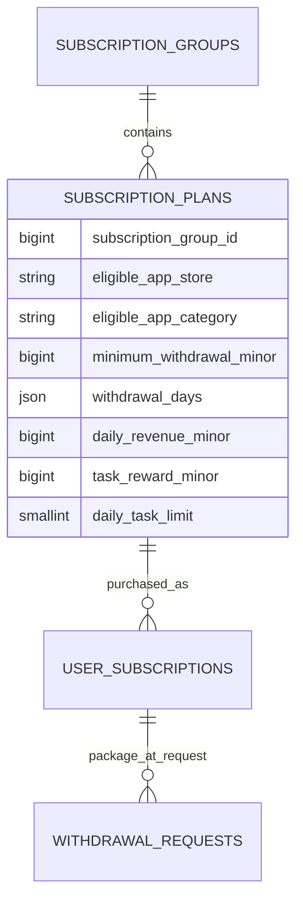

# Subscription package groups: database proposal

This is the proposed storage layer only. It does not change API responses,
purchase rules, app review eligibility, withdrawal validation, or Flutter pages.

## Structure

`subscription_groups` stores the selectable group name, description, order, and
active flag. Each plan belongs to a group. Store and category eligibility,
withdrawal terms, and daily task/revenue amounts are first-class plan columns;
the existing `features` JSON and `subscription_plan_features` remain for display
metadata during the transition.

Withdrawals gain a nullable link to the exact `user_subscriptions` row and a
snapshot of the package withdrawal terms used for that request. The columns are
nullable so existing withdrawal history remains valid.

## Seed data

| Group | Package | Billing | Price | Review limit | Ad share limit | Scope | Withdrawal / task terms |
|---|---|---:|---:|---:|---:|---|---|
| A | Lite | Monthly × 1 | NGN 1,500 | 0 | 1,000 | Ads | USD 8 minimum; monthly 28th; daily revenue cap |
| A | Premium | Monthly × 1 | NGN 3,500 | 0 | 120 | Ads | USD 10 minimum; monthly 28th; daily revenue cap |
| A | Gold | Monthly × 1 | NGN 6,200 | 0 | 140 | Ads | USD 18 minimum; monthly 28th; daily revenue cap |
| B | Playstore review | Monthly × 4 | NGN 12,150 | 360 | 0 | Google Play | NGN 3,000 minimum; Friday; NGN 630/day; NGN 210/survey; 3/day |
| B | Samsung store | Monthly × 4 | NGN 24,850 | 360 | 0 | Samsung Galaxy Store | NGN 3,000 minimum; Friday; NGN 990/day; NGN 330/survey; 3/day |
| C | Apple store | Monthly × 4 | NGN 57,750 | 360 | 0 | App category `Apple` | NGN 3,000 minimum; Friday and Wednesday; NGN 2,100/day; NGN 700/survey; 3/day |

The NGN figures above are user-facing major amounts. The `*_minor` columns use
the project's existing minor-unit convention (NGN kobo), so for example NGN
12,150 is stored as `price_minor = 1,215,000`. This follows the current USD
package convention, where USD 4.99 is stored as `price_minor = 499`.

The Group B packages use the app catalog's `store` value as their eligibility
key. The Apple package stores its requested category restriction in
`eligible_app_category = 'Apple'`.

Group A uses the reward configured on each ad. Its daily allowance is the
package's `daily_revenue_minor` and is enforced against approved ad-share
rewards credited that day, converted to the package currency when necessary.
Group A leaves `task_reward_minor` and `daily_task_limit` empty. Groups B and C
continue to use their per-survey reward and daily task count settings.

The package table no longer has a `global_listing_access` field. USD withdrawal
minimums are stored in minor units: USD 8, USD 10, and USD 18 become 800, 1,000,
and 1,800 respectively. Their `withdrawal_days` JSON value is `['Monthly 28th']`.

## Legacy location add-ons

The new seeder no longer creates location-coverage package records and marks
existing `location_coverage` plans inactive. Existing plan coverage and user
entitlement tables are retained for historical subscriptions until the later
application-layer migration can remove their readers and writers safely.

## Files in this proposal

- `2026_11_08_090000_restructure_subscription_package_groups.php` creates the
  groups, adds plan/withdrawal columns, and associates current marketplace
  plans with Group A.
- `SubscriptionGroupSeeder.php` seeds Groups A, B, and C.
- `SubscriptionPlanSeeder.php` seeds the six packages and retires legacy
  location add-on plans.

No migration or seeder has been run as part of preparing this proposal.
