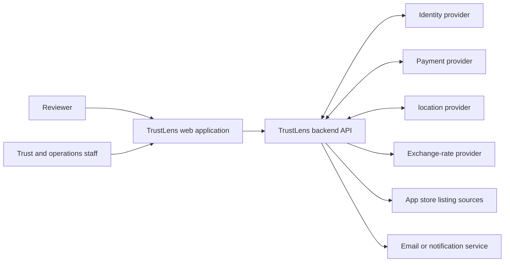
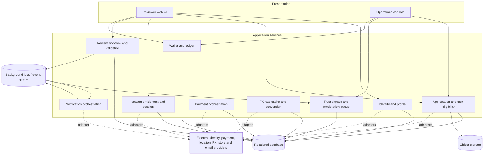
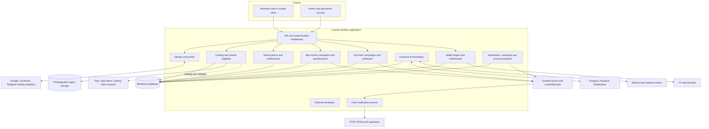
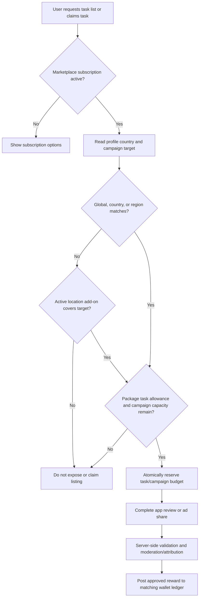

# TrustLens — Software Architecture Model

**Status:** Implementation baseline  
**Source:** `project-overview.html` (owner-provided prototype)  
**Purpose:** Translate the visible product flow, prototype data, and owner decisions into the implementation architecture.

**Scope update:** Section 12 incorporates the expanded requirements provided after the prototype review. Where earlier sections imply that users must buy a location session before earning, the updated rule is that an active marketplace subscription is required and additional location coverage is optional. Section 12 is the current architecture baseline.

## 1. Scope and evidence

The HTML presents a platform where people review mobile apps from Google Play, Apple App Store, and Samsung Galaxy Store. Reviewers select eligible app-review work, complete a questionnaire, submit the review for human approval, and see earnings and activity in a wallet. The expanded product also includes public sponsor-ad shares. Marketplace subscriptions are required; optional location coverage expands listing eligibility based on admin-defined country/region groups and does not use a technical location service.

The prototype includes three illustrative app records and hard-coded questionnaire rules. Its login, Google sign-in, checkout, location provisioning, review approval, and crediting are not connected to real services. State is kept in a JavaScript object and is lost on reload. Currency conversion fetches an external NGN exchange-rate feed and has hard-coded fallback rates.

This model assumes a production application with a backend API, durable storage, payment/social identity providers, and human admin moderation. Provider adapters and deployment credentials remain integration work.

## 2. System context



App store listing access is shown in the page, but the method of obtaining listing metadata and screenshots is unspecified. The model treats it as a backend integration boundary; manual catalog entry can be used until source access is selected.

## 3. Proposed logical architecture



For an initial release, these services can be modules in one backend application with a relational database and a worker process. Keep clear module boundaries and provider adapters; splitting them into separately deployed services is not required by the prototype.

## 4. Components and responsibilities

| Component | Responsibility |
|---|---|
| Reviewer web UI | Authentication screens, task list, location purchase flow, guided questionnaire, submission status, wallet and currency display. Treat all client state and calculations as untrusted. |
| Operations console | Manage app listings and task availability; inspect flagged submissions; make review decisions; view payment, location, and audit states. The HTML does not depict this console, but its verification promise requires an operational workflow. |
| Identity and profile | Email/social authentication, account lifecycle, country, session management, and account uniqueness checks. Do not use country or IP alone as proof of identity. |
| App catalog and eligibility | Store listing metadata, screenshots, developer details, task status, region/store targeting, and reviewer eligibility. |
| location entitlement and session | Start location purchase after confirmed payment, provision/revoke provider session, enforce region, duration and usage caps, and record expiry. |
| Payment orchestration | Create checkout/payment intents, validate provider callbacks, handle retries/refunds, and reconcile transactions. The browser must never collect or store raw card numbers or CVV. |
| Review workflow | Serve versioned questionnaires, save drafts, validate required answers server-side, prevent duplicate submissions, and transition a submission to pending verification. |
| Trust signals and moderation | Apply transparent quality checks and risk signals, route cases to staff, record decisions and reasons, and support appeal/correction processes. A questionnaire flag is a moderation signal, not a definitive fraud finding. |
| Wallet and ledger | Maintain immutable balanced entries for location charges, provisional review credits, approval/reversal, withdrawal, and adjustments. Expose derived balances and activity. |
| FX rate service | Retrieve and cache dated rates, label stale/reference values, and convert only for display. Store all monetary entries in a canonical currency and integer minor units. |
| Notifications and jobs | Send submission/decision/payment notices and run rate refresh, expiry, payment reconciliation, and moderation SLA jobs. |

## 5. Main domain model

```mermaid
erDiagram
  USER ||--o{ location_ENTITLEMENT : owns
  USER ||--o{ REVIEW_SUBMISSION : creates
  USER ||--|| WALLET : has
  APP ||--o{ REVIEW_TASK : offers
  REVIEW_TASK ||--o{ REVIEW_SUBMISSION : receives
  REVIEW_SUBMISSION ||--o{ ANSWER : contains
  REVIEW_SUBMISSION ||--o{ MODERATION_CASE : may_open
  WALLET ||--o{ LEDGER_ENTRY : records
  PAYMENT ||--o{ location_ENTITLEMENT : funds
  QUESTIONNAIRE_VERSION ||--o{ REVIEW_TASK : configures

  USER { string id PK; string email; string country; string status }
  APP { string id PK; string store; string name; string developer; string listing_url; string status }
  REVIEW_TASK { string id PK; string app_id FK; string questionnaire_version_id FK; string region; string status }
  PAYMENT { string id PK; string user_id FK; int amount_minor; string currency; string provider_status }
  location_ENTITLEMENT { string id PK; string user_id FK; string payment_id FK; datetime expires_at; int review_quota; string status }
  REVIEW_SUBMISSION { string id PK; string user_id FK; string task_id FK; string status; int reward_minor; datetime submitted_at }
  ANSWER { string id PK; string submission_id FK; string question_key; json value }
  MODERATION_CASE { string id PK; string submission_id FK; string status; string decision; string reason }
  WALLET { string id PK; string user_id FK; string currency }
  LEDGER_ENTRY { string id PK; string wallet_id FK; string kind; int amount_minor; string status; string reference_id }
  QUESTIONNAIRE_VERSION { string id PK; string version; json schema }
```

Suggested important invariants:

- One active entitlement is checked by the server before a task can be started or submitted; quotas and expiration are enforced server-side.
- A reviewer can submit at most once per task unless an explicit resubmission policy allows otherwise.
- Questionnaire schema/version and submitted answers are retained together for auditability.
- Payment provider callbacks are authenticated and idempotent. location access is activated only after a confirmed payment event.
- Wallet entries are append-only. The balance is calculated from ledger entries; a later approval or rejection creates a new entry rather than editing history.
- A submission's reward is provisional until verification resolves it. The UI must make clear whether the displayed amount is pending, approved, withdrawable, or reversed.

## 6. Key workflows

### A. Sign-in and task discovery

1. Reviewer signs in through the selected identity provider; the backend creates or loads the profile.
2. Backend returns eligible tasks based on account status, region/store needs, prior submissions, and any active restrictions.
3. UI displays task details from the catalog. Listing metadata and screenshots should have a source and last-verified timestamp.

### B. location purchase and activation

1. Reviewer selects a pass. Backend creates a payment intent for the server-defined price and pass terms.
2. Payment provider collects payment details through its hosted or tokenized checkout.
3. A verified, idempotent provider callback marks payment paid. A worker requests a region-matched location session.
4. Backend records entitlement expiry and quota, and returns session status without exposing provider secrets.
5. Expiry, provider failure, refund, or revocation disables task access and is visible in the activity history.

### C. Review submission and verification

1. Backend verifies task eligibility and active entitlement, then creates a submission tied to a questionnaire version.
2. UI collects answers. Server validates required fields, word counts, selection rules, timing/duplicate constraints, and consent confirmation.
3. Submission is stored as `PENDING_REVIEW`; trust signals are attached with reason codes, not silently used as a final verdict.
4. Moderation queue presents submission and relevant app/task context to staff. Decision and rationale are audited.
5. Approval posts the reward as available or provisional according to the selected payout policy. Rejection records a reason and appeal path; any reversal is a separate ledger entry.
6. Reviewer sees status changes and receives notification. “Within about an hour” should be an operational target, not an unconditional promise unless staffed and measured.

### D. Wallet and rates

1. Wallet API returns ledger-derived NGN totals split by pending, approved/available, and withdrawn amounts.
2. UI requests dated FX rates for display conversion. FX failure uses clearly marked cached/reference rates and does not alter wallet balances.
3. Withdrawal is a separate flow requiring a payout method, identity/compliance checks, fees/threshold policy, and payment reconciliation; it is not specified in the HTML.

## 7. Suggested API surface (prototype sketch; see Section 12 for current routes)

Illustrative REST endpoints; names and transport are design choices for review.

| Method and route | Purpose |
|---|---|
| `GET /api/v1/me` | Current profile and account state |
| `GET /api/v1/tasks` | Eligible app review tasks |
| `GET /api/v1/tasks/{taskId}` | Task details and questionnaire version |
| `POST /api/v1/location-purchases` | Create a pass purchase/payment intent |
| `GET /api/v1/location-entitlements/current` | Current entitlement and expiry/quota |
| `POST /api/v1/review-submissions` | Submit answers with idempotency key |
| `GET /api/v1/review-submissions/{id}` | Submission status and permitted feedback |
| `GET /api/v1/wallet` | Ledger-derived balance breakdown and activity |
| `GET /api/v1/fx-rates?base=NGN` | Dated conversion rates for display |
| `POST /api/v1/provider-webhooks/{provider}` | Payment/location provider events, signature-verified |
| `GET/POST /api/v1/ops/moderation-cases` | Restricted staff queue and decisions |

## 8. Cross-cutting requirements to settle

- **Security and privacy:** TLS, secure session cookies or equivalent, CSRF protection where applicable, rate limits, secrets management, role-based staff access, audit logs, data retention/deletion rules, and encryption for sensitive data. Never store raw card data. Define whether location logs or precise IP data are retained and for how long.
- **Financial correctness:** Keep campaign and wallet amounts in their configured currency; use integer minor units, idempotency, reconciliation, explicit pending/available states, and admin-settled withdrawals.
- **Abuse and fairness:** Define account uniqueness and collusion controls, review quality/duplicate policy, appeal handling, and how detection signals affect rewards. Avoid treating location/IP matching as reliable identity proof.
- **Store and platform rules:** The concept pays people to review third-party apps and share sponsor ads publicly. Before launch, the owner should confirm that incentives, review collection, and public ad disclosures comply with relevant platform policies, provider contracts, and local law. The current workflow stores TrustLens review answers separately from store review counts.
- **Reliability:** Provider integrations need retries, idempotency, timeouts, reconciliation jobs, monitoring, and operator workflows for stuck payment/location/moderation states.
- **Accessibility and localization:** Retain the prototype's keyboard/focus considerations, add screen-reader labels and validation, and define supported locales/currencies and localization rules.

## 9. Confirmed product decisions

The earlier product questions have been answered. Section 12 is the current source of truth for admin-managed subscriptions and regions, country-based eligibility, campaign reward pools and caps, human approval, public ad-share evidence, wallet funding and withdrawals, payment selection, and the separate admin identity. Privacy retention, appeals, launch compliance review, and provider credentials remain operational work before launch.

## 10. Prototype-to-production gaps

| Prototype behavior | Production implication |
|---|---|
| In-memory `S` object | Persist users, entitlements, submissions, answers, and ledger in backend storage. |
| Client-side email validation and fabricated Google identity | Real identity provider, server-side validation, secure session lifecycle, abuse controls. |
| Card number/expiry/CVV fields and delayed local success | Replace with hosted/tokenized provider checkout and verified callbacks. |
| Local timer and random session ID | Provision and monitor real location sessions; authoritative expiry/quota enforced by backend. |
| Review marks complete and adds ₦600 immediately | Server submission state machine, moderation, explicit pending/available balance policy, auditable ledger. |
| Hard-coded apps/questions and heuristic flags | Managed catalog, versioned forms, documented quality policy and moderation tooling. |
| Direct browser fetch for FX | Backend/cache adapter, rate timestamp and freshness policy. |
| No withdrawal function | Decide whether wallet is informational or redeemable; implement payout and reconciliation if redeemable. |

## 11. Review boundary

This model covers the capabilities and screens represented in the supplied HTML. It does not establish production requirements for scale, deployment topology, provider selection, public store review submission, withdrawals, legal basis, or moderation policy. Confirm the decisions in section 9 before turning this into a detailed implementation plan.

## 12. Expanded platform architecture (current scope)

### Product capabilities and access rules

The platform has two sponsored campaign types:

- **App review campaigns:** an owner funds a maximum number of eligible review tasks. A reviewer inspects the app/listing, sees its icon, screenshots and versioned questions, and earns the configured reward after the campaign's review policy approves the submission.
- **Ad share campaigns:** an owner funds a maximum number of eligible shares. A reviewer shares approved campaign content through a supported channel and earns the configured reward after the share is attributed and validated.

Users select a country during registration. That country is the default market used to discover country-targeted and global listings; it is not location proof by itself. A user needs an active **marketplace access subscription** to claim either task type. Three base packages are planned, sold monthly, with package features governing task limits and whether broader/global inventory is visible. Buying the base subscription is sufficient to earn from eligible tasks in the user's normal market; buying extra location coverage is optional.

An optional **location coverage add-on** unlocks additional country or region inventory for a defined period. It has three coverage tiers and can be sold for weekly, monthly or quarterly durations. Coverage grants should be modeled as time-bound entitlements. They should not be conflated with physical location verification or with the old prototype's per-session location purchase; the technical meaning and compliance basis of region-matched access remain owner decisions.

### Expanded system structure



Start with a Laravel modular monolith, relational database, queue worker and object storage. Keep explicit modules and provider adapters. Payments, task fulfillment, ledgers and entitlements need transactional writes; push delivery, store metadata refresh, attribution checks and notifications can run asynchronously. Do not split into microservices until operating load or team ownership requires it.

### Recommended data model

| Area | Tables / key data | Notes |
|---|---|---|
| Identity | `users`, `social_identities`, `user_devices` | User stores `full_name`, unique username, email, phone, avatar/cover paths, country code, display-currency preference, ban state/reason and role/status. Unique provider+subject pairs. Store push tokens per device with revocation and platform. |
| Markets | `countries`, `regions`, `region_countries` | Normalize ISO country codes and region membership. `NULL` listing location means global. For one target, a listing may store a country/region key; for multiple targets, use join tables instead of comma-separated country codes. |
| App catalog | `apps`, `app_screenshots` | Store stable app/store identity, title, developer, description, icon, store rating/count and ordered screenshots with storage path/source/alt text. Keep store-sourced `total_reviews` distinct from platform review-task count. |
| Review campaign | `app_review_campaigns` (or campaign fields on `apps` only if one campaign per app is guaranteed) | `owner_id`, `app_id`, `paid_amount`, `currency`, target location, `review_reward`, `maximum_review`, counters, state, start/end. Campaign funding and cap should be independent from app catalog metadata. |
| Questions | `review_templates`, `review_template_versions`, `review_questions`, `review_options` | Preserve the extracted question model. Publish immutable versions so historical answers remain interpretable. |
| Review fulfillment | `review_tasks` or assignments, `review_submissions`, `review_answers`, `moderation_decisions` | Separate funded campaign capacity from a user's assignment/submission. Use states such as available, reserved, submitted, pending approval, approved, rejected, expired. |
| Ad campaigns | `ads` | Owner, creative, share text, destination URL, `paid_amount`, `currency`, target location, `share_reward`, `maximum_share`, approved share count, schedule and moderation status. |
| Share fulfillment | `ad_share_tasks`, `ad_share_events` | Claim and attribution are separate. Record user, campaign, channel, tracking token/URL, timestamps, evidence/verification, status and idempotency key. Never pay merely because the client says “shared.” |
| Subscription catalog | `subscription_plans`, `subscription_plan_features`, `plan_location_coverage` | `product_type` separates marketplace access from location add-ons. Store cadence, price/currency, limits, global access feature and supported countries/regions. Three base packages are monthly; location products have weekly, monthly and quarterly terms and three coverage tiers. `discount`, `bonus`, and `is_special` are persisted; confirm discount units (percentage or amount) and bonus currency before production billing. |
| User entitlements | `user_subscriptions`, `user_location_entitlements` | Persist provider payment reference, plan snapshot, status, start/end, renew/cancel state. Entitlements are checked server-side for every claim and submission. Keep base marketplace access independent from optional extra coverage. |
| Payments | `payment_intents`, `payment_transactions`, `payment_webhook_events`, `manual_deposit_submissions` | Provider-neutral records plus provider reference, currency, amount, status, signature/reconciliation state, idempotency. Manual deposits require pending proof/reconciliation and staff approval; never mark paid from an upload alone. |
| Wallets | `wallets`, `ledger_entries`, `withdrawal_requests`, `withdrawal_options` | One wallet per user and wallet type: `review`, `share`, `referral`, `topup_fund`. Ledger is append-only. Keep top-up funds separate from earned balances and prevent cross-wallet spending unless policy expressly permits it. |
| Referral | `referral_codes`, `referral_attributions`, `referral_rewards` | Use an explicit attribution window and anti-self-referral rules. Post rewards as referral-wallet ledger entries only after the qualified event. |
| Operations | `audit_logs`, `risk_signals`, `outbox_events` | Auditable admin changes, fraud/review reasons and reliable event delivery. Avoid storing secrets or unnecessary sensitive evidence. |

### Listing and campaign fields

The requested app fields are represented in the supplied app-listing demo schema: `paid_amount`, nullable `location`, `currency`, store `rating`, store `total_reviews`, `review_reward`, `app_icon`, and `maximum_review`. The demo seed uses zero amounts, no configured review cap, no store rating/count, global location, and explicit `prototype://` icon placeholders because real campaign budgets and icons were not provided. These are visibly non-production values. The new `app_review_campaigns` table is the production source of truth for funded, owner-specific campaigns; the campaign-like columns on `apps` are retained to match the requested listing shape and should be treated as prototype/default fields when multiple campaigns per app are supported.

The requested ad fields are represented in `ads`: `paid_amount`, nullable `location`, `currency`, `total_share`, `share_reward`, and `maximum_share`, with supporting owner, creative, destination, schedule and status fields. `total_share` should count validated/approved shares; claims, clicks and pending proofs need separate counters/events. For production, consider separating campaign budget/reward/cap fields into `app_review_campaigns`, because app metadata can outlive multiple owners, markets and campaigns.

All money is stored in campaign/payment currency with a currency code. Conversion to a user's preferred display currency is a view using a dated FX quote; never rewrite a ledger amount when the user changes currency. Use integer minor units for ledger/payment math (or carefully constrained decimals at catalog boundaries) and define rounding rules.

### Subscription, location and eligibility decision flow



Eligibility must be evaluated by the API, not hidden only in the UI. Apply the same checks at list, claim, submit and reward time to handle expiry/races. Reserve campaign budget and task capacity atomically so concurrent users cannot exceed `maximum_review`/`maximum_share` or overspend `paid_amount`. Release reservations on timeout, reject, or cancellation according to a defined policy.

### Separate wallet semantics

Use wallet types `review`, `share`, `referral`, and `topup_fund`, each with its own ledger-derived available, pending, reserved and withdrawn amounts. A review approval credits only the review wallet; a validated share credits only the share wallet; a referral event credits referral wallet; a successful top-up credits top-up funds. Subscription charges should specify which source is allowed. Withdrawal options should declare supported wallet types, country/currency, minimum, fee type and availability. The supplied `withdrawal_options.tax` needs a decision whether it means percentage, fixed fee, or tax withholding before calculation is implemented.

### Main user workflows

1. **Registration:** user registers with email or Google/Facebook/Telegram; backend verifies provider identity, captures a supported country code, records terms consent and creates a profile. Telegram uses its own signed login validation adapter rather than assuming generic OAuth behavior.
2. **Subscribe:** client selects one of three marketplace plans; backend starts provider checkout. A verified webhook or reconciled manual deposit marks payment successful and creates a time-bounded subscription entitlement. Provider callbacks are idempotent.
3. **Discover and claim:** API returns apps and ads eligible for user's active plan, country/region coverage, campaign status, remaining budget, category/age rules and prior task history. Claim creates a time-limited reservation.
4. **Review app:** app detail includes icon, screenshots and questionnaire version. Submission stores answers and review state. Moderation decision posts a reward to review wallet only if policy approves.
5. **Share sponsor ad:** show sponsor creative/disclosure and eligible share channel. Create a per-user tracking URL or supported proof request. A validator confirms the configured action before crediting share wallet. Define restrictions on self-dealing, spam, repeated sharing and unsupported channels.
6. **Top up and pay:** top-up uses a provider intent and verified webhook. Subscription or add-on payment and account top-up are distinct transactions, even when the same gateway is used. Manual deposit is a pending case until reconciled by authorized staff.
7. **Withdraw:** user selects eligible withdrawal option and wallet, submits required payout fields, sees minimum/fee, and creates a pending withdrawal. Staff/provider processing then settles or rejects it with audit trail and appropriate ledger entries.
8. **Push:** device registers token; events such as subscription expiry, task completion, review decision, deposit confirmation, share approval, withdrawal status and safety notices are delivered through FCM/APNs. In-app notification history remains the source of truth if push fails.

### Provider boundary and API modules

Use a provider adapter interface so Korapay, Paystack and Flutterwave implement create/verify/refund/webhook normalization independently. Treat manual bank deposit as its own review workflow. Social login adapters cover Google, Facebook and Telegram. Push provider adapters support FCM/APNs. Store listing imports should preserve source URL, retrieval time and permitted use; manual admin curation is a supported fallback.

Suggested API groups:

| Group | Example routes |
|---|---|
| Identity/profile | `POST /api/v1/auth/{provider}/callback`, `GET /api/v1/me`, `PATCH /api/v1/me/country`, `POST /api/v1/devices` |
| Catalog and eligibility | `GET /api/v1/listings?type=app_review`, `GET /api/v1/listings?type=ad_share`, `POST /api/v1/tasks/{id}/claim` |
| Plans and entitlements | `GET /api/v1/subscription-plans`, `POST /api/v1/subscriptions`, `GET /api/v1/me/entitlements`, `POST /api/v1/location-addons` |
| Fulfillment | `POST /api/v1/review-submissions`, `POST /api/v1/ad-shares`, `GET /api/v1/tasks/{id}/status` |
| Payments/topups | `POST /api/v1/payment-intents`, `POST /api/v1/topups`, `POST /api/v1/manual-deposits`, `POST /api/v1/webhooks/{provider}` |
| Wallet and withdrawal | `GET /api/v1/wallets`, `GET /api/v1/wallets/{type}/ledger`, `GET /api/v1/withdrawal-options`, `POST /api/v1/withdrawals` |
| Operations | restricted campaign, plan, moderation, manual-deposit, withdrawal and reconciliation routes with audit logging |

### Security, correctness and operational constraints

- Require active subscription, entitlement and campaign capacity on server-side claim and completion transactions.
- Keep OAuth/provider secrets, payment credentials, payout details, webhook payloads and push tokens protected; redact logs. Use signed webhook verification, timestamp/replay protection, idempotency keys and daily payment/ledger reconciliation.
- Do not store raw card data. Manual bank deposits require human reconciliation and dual-control policy for high-value adjustments.
- Use append-only ledger entries with a unique source event; corrections are reversals/new entries, never edits. Keep the four wallet balances isolated.
- Prevent campaign overspend with reservation accounting and atomic row locks/transactions. Reward sum plus fees must fit the funded campaign amount; the exact fee model must be defined.
- Validate share attribution without encouraging spam or deceptive endorsements. Make sponsor disclosure and permitted share channels visible.
- Country selection drives default access, but should not imply location verification. Define location verification, data collection, regional content rules and privacy retention before using location add-ons.
- Push is best-effort; persist notification events and provide in-app inbox/status so no financial outcome depends on push delivery.
- Apply role-based access, immutable audit history, file upload scanning, URL validation/SSRF protection for creatives, rate limits and abuse review.
- Seek appropriate legal/product review for incentivized app-store reviews, ad sharing, consumer disclosures, taxes, payouts and country-specific payment rules. Do not solicit fake public app-store ratings; distinguish private product research from public store reviews.

### Confirmed implementation decisions

1. Admins configure marketplace plan features, prices, review/share limits and global-listing access. The API reads the active plan configuration rather than hard-coding Lite/Premium/Gold behavior.
2. Location add-ons grant listing eligibility only. Admins define regions and their included countries, then assign regions to coverage tiers. An entitlement may cover a target listing through its country or region. No device/IP location service is used for eligibility. Overlapping active coverage is harmless and should not duplicate access.
3. Campaign `paid_amount` is the reward pool. Admins set `maximum_review` and `maximum_share`; campaign completion counters track reviews/shares and the campaign is exhausted at its configured maximum. `apps.total_reviews` counts approved TrustLens reviews, while external app-store review totals remain in `app_store_listing_snapshots`.
4. Review submissions and public ad-share evidence remain pending until a human admin decision. Approval credits the corresponding earned wallet; rejection records the admin, decision and reason. No automatic reward is posted before approval.
5. Ad sharing is a public post and verification is manual. The API records submitted evidence and queues it for admin review; it does not claim that a post is verified by a provider.
6. Only the top-up wallet can pay marketplace subscriptions and location add-ons. Top-up funds cannot be withdrawn. A user may transfer top-up balance to an eligible earned wallet without a transfer fee; the transfer must be an auditable ledger operation. Review, share and referral wallets are withdrawable subject to minimum and fee rules.
7. Users choose an active configured payment gateway. Manual bank deposits require uploaded proof and admin approval. Campaign currency is fixed by the campaign; FX is for display and does not alter ledger amounts.
8. Withdrawal `tax` is a percentage fee. All configured withdrawal methods are selectable by all users; each request still validates required payout fields, minimum, currency and available earned-wallet balance.
9. Profile country is the sole country eligibility input for now; residence is not verified. Listings may be global, country-targeted or region-targeted. Region access is determined from admin-maintained country membership and active entitlements.
10. Admin accounts are stored in a separate `admins` table. Admins manage listings/content, screenshots, plans, regions and settings; they approve review/share evidence, manual deposits and withdrawal settlement. Every administrative decision and financial operation is auditable.

Admin-controlled values (plan features/prices, location prices/coverage, withdrawal options, countries/regions, gateway activation and campaign caps) must be read from persisted configuration. Provider credentials remain server-side configuration and are never editable through public API responses.

### API implementation constraints

- Enforce marketplace subscription and location eligibility on every catalog/claim/submit request. Country-targeted listings match only the user's profile country; a valid add-on can grant eligibility for other countries/regions.
- Reserve campaign capacity transactionally when creating a task. Human approval increments the campaign completion count and posts an idempotent ledger credit; rejection releases the reservation. Reaching the configured maximum marks the campaign exhausted.
- Use the top-up wallet only for subscription/add-on checkout and balance transfers. Withdrawal endpoints reject the top-up wallet regardless of client input.
- Payment initiation uses the user's selected active gateway, but authoritative amount/currency come from the server-side plan, add-on, or campaign. Manual-deposit approval is an explicit admin action.
- Admin authentication and authorization use the separate `admins` identity table and Sanctum tokens; end-user roles cannot access operations routes.

### Recommended build sequence

1. Finalize access/eligibility matrix, subscription features, campaign budgets, currencies and wallet rules.
2. Build identity, country/region catalog, app/ad campaign administration and asset storage.
3. Build payment adapters and reconciliation, then subscription and optional location entitlements.
4. Build task reservation, app questionnaire submissions, ad-share attribution and moderation.
5. Build separate wallets, ledger, top-up and withdrawal workflows with audit/reconciliation.
6. Add push/in-app notifications, operational dashboards, abuse controls, policy review and launch hardening.

### Database tables created from this model

The existing migrations provide `apps`, `app_screenshots`, `review_questions`, `withdrawal_options`, and `ads`. The domain migration adds:

- **Identity and markets:** `users`, `social_identities`, `user_devices`, `countries`, `regions`, `region_countries`.
- **App review:** `app_review_campaigns`, `app_store_listing_snapshots`, `review_templates`, `review_template_versions`, `review_template_version_questions`, `review_tasks`, `review_submissions`, `review_answers`, `moderation_decisions`.
- **Ad sharing:** `ad_share_tasks`, `ad_share_events`.
- **Subscriptions and coverage:** `subscription_plans`, `subscription_plan_features`, `plan_location_coverage`, `user_subscriptions`, `user_location_entitlements`.
- **Payments:** `payment_intents`, `payment_transactions`, `payment_webhook_events`, `manual_deposit_submissions`.
- **Wallet and withdrawals:** `wallets`, `ledger_entries`, `withdrawal_requests`, `referral_codes`, `referral_attributions`, `referral_rewards`.
- **Operations and integrations:** `notifications`, `notification_deliveries`, `risk_signals`, `audit_logs`, `outbox_events`, `exchange_rate_snapshots`.

These are schema foundations. The demo seeders populate representative country/region, plan, campaign and wallet records. Admin configuration remains authoritative for production prices, coverage, campaign caps and withdrawal options.

The local/testing/staging demo seeders provide illustrative values to exercise those flows. FX values are explicitly tagged `demo_seed_not_live`; plan prices, discounts/bonuses, sample ratings, campaigns, task outcomes and deposits are fixture data. They must not be treated as launch configuration or real payment evidence. Admins configure production location add-on prices and coverage through the API.

Follow-up migrations rename `users.name` to `users.full_name`, add username/contact/image/ban fields, add `discount`, `bonus`, and `is_special` to `subscription_plans`, add stable idempotency keys for demo activity, and create separate `admins` and `system_settings` tables. They also attach admin identities to moderation, manual deposit, withdrawal, settings and audit records. In local, testing, and staging environments, `DatabaseSeeder` creates 15 `@tlstore.test` accounts (shared demo password: `DemoPass!2026`), a demo admin (`admin@tlstore.test` / `DemoAdmin!2026`), 20 USD-based demo FX quotes, three Lite/Premium/Gold monthly access plans, three Starter/Basic/Premium weekly/monthly/quarterly location add-ons, country/region reference data, and representative activity across review, share, payment, wallet, withdrawal, referral, notification, audit, risk and outbox tables. Demo credentials must be replaced before any exposed environment. Demo records are fixtures, not real payment evidence. `DatabaseSeeder` skips the demo dataset in production.
